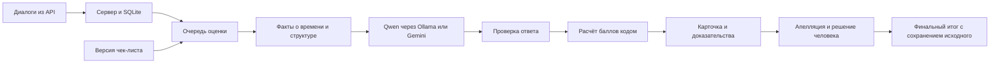

# CQA / Saw-cell — разбор проекта для защиты

Срез: 8 ноября 2026. Этот разбор дополняет [сценарий на троих](PITCH_5_MIN_RU.md)
и [план контрольного часа](CONTROL_HOUR_RU.md). Для защиты используйте свежий
сценарий с полным циклом апелляции и заменой критерия.

В финальном DEV используется Qwen/v18. Приведённые ниже 96% и старые баллы
относятся к историческому Qwen/v16. Сверка финального DEV со старой
разметкой команды приведена в `results/dev/quality-summary.json`.

## 1. Суть, которую должны понимать все трое

**CQA — Conversation Quality Analytics: система первичной оценки работы
операторов в клиентских чатах и звонках по настраиваемому чек-листу.**

На входе — диалог и правила компании. На выходе — оценка каждого критерия,
обоснование, ссылки на реплики, общий балл и отдельный флаг грубого нарушения.
Сотрудник может оспорить конкретный критерий; проверяющий подтверждает или
меняет результат. Первоначальная оценка сохраняется.

Операционные пользователи — контроль качества, руководители поддержки и
операторы. HR может использовать результаты для обратной связи и обучения.
Отдельной системы учебных курсов, кадровых решений или персональных планов
развития в текущем приложении нет.

Пользу для Freedom Broker подавайте как предложение, которое нужно проверить
на пилоте. В репозитории нет подтверждения того, как именно сейчас устроен
внутренний контроль компании, сколько диалогов она проверяет и сколько тратит.
Не говорите от её имени «у вас сейчас нет обоснований» или «вы проверяете 2%».

## 2. Почему решение стоит показать

| Возможность | Практический смысл | Статус |
|---|---|---|
| Пакетная оценка по чек-листу | Снимает часть первичного ручного разбора | Реализована; экономия рабочего времени ещё не измерена |
| Ссылки на конкретные реплики | Можно быстро проверить основание и объяснить оценку сотруднику | Реализованы для текста и перехода в аудио по меткам |
| Апелляция и решение человека | Сотрудник может оспорить ошибку; модель не является последней инстанцией | Реализованы; роли пока демонстрационные |
| Сохранение исходной и итоговой оценки | Видно, что предложила модель и что изменил проверяющий | Реализовано; это не полноценный защищённый корпоративный аудит |
| Версии чек-листа | Изменение стандартов не требует переписывать весь интерфейс | Реализованы |
| Повторное использование неизменённых результатов | При изменении части правил сокращается объём повторной оценки | Реализовано при совпадении остальных условий кеша |
| RU / KZ / EN и чаты / звонки | Один рабочий процесс для нескольких языков и каналов | Есть в DEV; все 5 DEV-звонков на русском |
| Выбор Qwen / Gemini | Можно выбирать инфраструктуру для текстового анализа | Реализован; полный закрытый аудиоконтур ещё не доказан |

Аргумент против вопроса «а почему не просто отправить текст в чат с ИИ?»:
готовая модель умеет анализировать текст, но здесь дополнительно реализованы
версии правил, проверяемые ссылки, единая арифметика, очередь, сохранение
результатов, апелляции и экспорт. В этом состоит инженерная работа команды.
Не заявляйте, что таких функций нет у конкурентов: актуального сравнения рынка
в этой подготовке не проводилось.

## 3. Как всё устроено — без магии

1. **Импорт.** Сервер получает набор по `group_id`, нормализует сообщения,
   сохраняет диалоги и проверяет состав набора. DEV: 65 диалогов — 60 чатов,
   5 звонков; 35 RU, 15 KZ, 15 EN с учётом звонков.
2. **Правила.** Для задания фиксируется версия чек-листа. У критериев есть
   описание, вес, тип ответа, допустимая шкала и условия неприменимости.
3. **Очередь.** Сервер обрабатывает задания с ограниченной параллельностью.
   Настройки модели фиксируются для задания; состояние сохраняется в SQLite.
4. **Подготовка.** Код рассчитывает длительности по меткам времени и выделяет
   некоторые признаки разговора. Поиск предупреждений об ожидании,
   идентификации и уточняющих вопросов частично основан на текстовых шаблонах;
   это полезные подсказки, а не доказательство полного понимания смысла.
5. **Модель.** В запрос входят чек-лист, правила оценки, диалог с ID реплик
   и рассчитанные факты. Модель возвращает структурированный результат.
6. **Валидация.** Код проверяет допустимые ответы, шкалы, N/A, существование
   реплик и диапазонов. Невалидный ответ получает одну попытку исправления
   с обратной связью. Отдельно предусмотрены повторы временных сетевых ошибок.
7. **Цитаты.** Проверка цитат отмечает подозрительные совпадения и проблемы
   привязки/автора. Она не доказывает правильность каждого смыслового вывода.
8. **Арифметика.** Веса, нормализация, округление и флаг считаются кодом,
   а не принимаются как произвольный итог от модели.
9. **Проверка человеком.** В апелляции можно подтвердить или изменить критерий.
   Решение, причина и первоначальный ответ сохраняются; итог пересчитывается.

Стек: Node.js, Express, встроенная SQLite; интерфейс — HTML/CSS/JavaScript;
текстовая модель — Qwen через Ollama либо Gemini. Node нужен версии не ниже
22.13. Это работающий прототип на одном сервере, без доказанного промышленного
масштабирования на множество независимых работников очереди.

## 4. Восемь критериев и расчёт

| ID | Что проверяет | Вес | Ответ / шкала | N/A |
|---|---|---:|---|---|
| c01 | Установление контакта | 10 | Да / нет | Нет |
| c02 | Выявление потребности | 15 | Да / нет | Да |
| c03 | Идентификация | 20 | Да / нет | Да |
| c04 | Корректная и полная консультация | 20 | 0, 5, 10, 15, 20 | Да |
| c05 | Эмпатия и клиентоориентированность | 15 | Да / нет | Нет |
| c06 | Управление диалогом, скорость и грамотность | 15 | 0, 4, 7, 10 | Нет |
| c07 | Завершение | 5 | Да / нет | Да |
| c08 | Грубые ошибки | 0 | Да = нарушение найдено | Нет |

**N/A** означает «критерий не применим», а не «модель не уверена».
Например, общий вопрос о навигации не требует идентификации. Условие N/A
должно быть разрешено чек-листом и выполнено в диалоге.

Для применимого критерия: баллы = вес × доля выполненной шкалы.
Для бинарного критерия эта доля — 1 или 0.

**Итог = 100 × сумма полученных баллов / сумма весов применимых критериев.**
Округление — до двух знаков. Если нет применимых балльных критериев, итог
отсутствует (`null`), а не равен 100.

Пример `p1-ru-003`: идентификация N/A убирает вес 20. Консультация 10/20
даёт 10 баллов. Управление диалогом 7/10 при весе 15 даёт 10,5 балла.
Остальные применимые критерии выполнены: сумма 65,5 из 80 → **81,88**.

**Грубая ошибка — отдельный флаг.** Он не обнуляет итог автоматически.
У этого критерия «да» означает плохое событие; у обычного бинарного критерия
«да» означает выполнение требования. Не путать на защите.

Чек-лист перечисляет оскорбление, предложение платной услуги в обход компании
и раскрытие конфиденциальной информации. В методических подсказках модели
трактовка раскрытия данных уже, чем широкая формулировка критерия; эту границу
нужно согласовать с экспертом компании. Совпадение с нашей разметкой не
заменяет согласование реального стандарта безопасности.

## 5. Цифры, которые можно защищать

Источник: `eval/reports/2026-11-07T19-25-48-821Z.json`, он же текущий `latest.json`.
Дата внутри отчёта в UTC; в Алматы этот прогон завершился уже 8 ноября.

| Показатель | Значение | Что это означает |
|---|---:|---|
| Модель / промпт | Qwen3.6-35B-A3B / v16 | Конкретная оценочная конфигурация, а не любая модель |
| Диалоги | 65 | Небольшой DEV-набор команды |
| Ошибки обработки | 0 | Все оценки получены; смысловая безошибочность из этого не следует |
| Совпадение по критериям | 499 из 520, округлённо 96% | 65 × 8 ответов; 21 расхождение с разметкой |
| MAE итогового балла | 2,61 | Среднее абсолютное расхождение по шкале 0–100; не максимум ошибки |
| Совпадение флага грубой ошибки | 65 из 65 | В разметке всего 5 положительных и 60 отрицательных случаев |
| Слабейшие критерии | c02 и c06: по 89,2% | Выявление потребности и управление диалогом |
| Прогон всей выборки | ≈6,7 минуты по README / GPU-отчёту | Исторический замер пакета на L40S; не SLA |
| Средняя длительность вызова в eval | 19,3 секунды, 82 вызова | Время одной HTTP-попытки; не среднее полное время диалога |

**Главная оговорка:** разметка сделана командой, правила промпта улучшались
на этих же диалогах. Это согласие с DEV-разметкой, не независимый тест на
новых клиентах и не измерение справедливости оценки сотрудников.

Если спрашивают «96% чего?» — «499 из 520 решений по отдельным критериям
совпали с нашей DEV-разметкой». Это не доля диалогов без единой ошибки.

**Не смешивать два артефакта.** Экспорт `results/dev/results.json` — отдельный
прогон той же модели и v16. Его прямая сверка даёт 498/520 совпадений (≈95,8%).
В речи 96% относятся к оценочному отчёту. На уровне отдельных диалогов ответы
между прогонами могут отличаться. В происхождении экспорта записан один
ответ модели (`samples=1`), thinking выключен, окно контекста 16384.
Не приписывать эти цифры голосованию из трёх ответов.

Возможность нескольких ответов и голосования есть, но её преимущество на
этом наборе здесь не доказано. Больше вызовов также означает больше времени
и ресурсов. Нельзя говорить «голосование всегда повышает точность».

## 6. Реальный пример для демо

**Основной: `p1-ru-003`, оценка 81,88 в сохранённом DEV-экспорте.**

- m013: оператор объясняет, где посмотреть название тарифа.
- m014: клиент спрашивает: «Да, “Инвестор”. А комиссию где искать?»
- m015: оператор повторяет ответ про название тарифа и прощается.
- c04 получает 10/20 за неполную консультацию.
- c03 получает N/A: общий информационный запрос не требует идентификации.

Показать карточку → c04 → ссылку на m014/m015 → N/A → форму апелляции.
Этого достаточно для 5-минутного питча. Не обещайте показать все страницы.

Смысл для HR: можно обсудить конкретный навык — заметить второй вопрос клиента
и ответить до завершения разговора. Система сама не создаёт учебный курс;
она предоставляет материал для разбора.

**Дополнительный пример для вопросов:** `p1-ru-018`, итог 16, грубая ошибка
не отмечена. Он показывает, что очень плохая консультация и отдельный тип
грубого нарушения — разные признаки.

**Звонок для дополнительного показа:** `p4-ru-004`, итог 95,26 в экспорте.
Перед защитой проверить звук и точность перемотки на выбранной реплике.
Наличие меток времени не доказывает идеальное совпадение с аудио.

**Апелляция:** если показываете только форму, не говорите, что решение уже
сохранено. Для полного сценария после основной речи используйте копию базы:
подать комментарий → открыть проверяющего → подтвердить или обоснованно
изменить критерий → показать исходный и финальный итог. Не повышайте балл
только ради красивого демо; учебное изменение прямо называйте демонстрацией.

## 7. Внедрение, данные и стоимость

**Локальная модель** здесь означает собственное размещение модели на GPU,
в том числе арендованном удалённом сервере. Это не обязательно компьютер
в офисе и не доказательство работы внутри инфраструктуры Freedom Broker.

В режиме Ollama текст можно анализировать без обращения к облачной LLM.
Однако размещение сервера, публичный доступ, хранение данных и обработка
аудио — отдельные вопросы. В интерфейсе расшифровка использует Gemini и
передаёт запись внешнему сервису. `faster-whisper` проверяли отдельным GPU-
скриптом; полноценная замена им интерфейсного аудиопроцесса не подтверждена.

Режим `auto` выбирает доступного провайдера при создании нового задания:
Ollama, если он доступен, иначе Gemini. Это не гарантированный переход
посреди уже упавшего запроса. Для требования «никаких облачных LLM» выбирают
фиксированный Ollama и отдельно обеспечивают нужный аудиопроцесс.

**Стоимость:** $0, записанные для Ollama, — отсутствие платы за токены
внешнему провайдеру. GPU, хранение, обслуживание и время проверяющего стоят
денег. Облачная стоимость считается по токенам и настроенным ставкам;
эти ставки нужно актуализировать, это не счёт от провайдера.

Экономику пилота считать так:

`выгода = стоимость времени до − стоимость времени после − инфраструктура − эксплуатация`.

Измерять одинаковую выборку: ручную проверку и проверку с CQA, включая время
на ошибки модели и апелляции. Своего измеренного ROI пока нет.

**До промышленного внедрения:** корпоративная авторизация и серверные права,
интеграция с реальным источником диалогов, правила хранения и доступа,
наблюдаемость, резервное копирование, нагрузочные испытания и независимая
проверка качества. Текущий переключатель «Оператор / Проверяющий» в интерфейсе
не подтверждает личность и не ограничивает серверные API полноценными ролями.

`web/d365.js` только обнаруживает `Xrm` в Dynamics 365. Готовой интеграции,
проверенной в рабочей CRM компании, в просмотренном коде нет.

## 8. Вопросы жюри — короткие ответы

**1. Что вы сделали сами, если модель готовая? — Участник 3.**
«Мы разработали процесс вокруг модели: импорт и очередь, активный чек-лист,
проверку ответов и доказательств, расчёт баллов, апелляции, версии, интерфейс
и экспорт. Собственную базовую модель не обучали».

**2. Какой результат получит HR? — Участник 1.**
«Конкретные примеры для обратной связи и обучения сотрудников. Можно показать,
какое действие в разговоре стоит улучшить. Эффект на обучение надо измерить
в пилоте; автоматических кадровых решений система не реализует».

**3. Почему можно доверять 96%? — Участник 3.**
«Это проверяемое совпадение 499 из 520 ответов с нашей DEV-разметкой.
Мы на ней улучшали промпт, поэтому независимую точность ещё предстоит измерить».

**4. А если модель ошибётся? — Участник 2, техническое дополнение 3.**
«Можно открыть основание, подать апелляцию и изменить результат решением
проверяющего. Формальные ошибки отлавливает код, смысловые требуют проверки».

**5. У вас 100% обнаружения нарушений? — Участник 3.**
«В этом DEV-прогоне флаг совпал во всех 65 диалогах, но положительных случаев
только пять. Это не даёт гарантии обнаружения всех новых нарушений».

**6. Можно использовать балл для премий и увольнений? — Участник 1.**
«Текущий прототип даёт материал для разбора разговора. Для кадровых решений
нужны отдельная проверка качества и справедливости, правила компании и
ответственное решение человека. Такой автоматический процесс мы не заявляем».

**7. Как проверяете правильность финансовой консультации? — Участник 3.**
«Сейчас по диалогу и правилам чек-листа. Подключённой актуальной базы тарифов
и регламентов компании нет. Поэтому фактическая корректность специфических
условий продукта остаётся ограничением; для пилота нужен доверенный источник».

**8. Почему именно Qwen? — Участник 3.**
«Он работает на нашем GPU и дал этот измеренный результат на нашей задаче.
Это выбор по имеющемуся прогону, а не утверждение, что он лучше всех моделей.
Провайдер отделён от остальной системы, есть также Gemini».

**9. Данные точно никуда не уходят? — Участник 3.**
«Это зависит от выбранного развёртывания. Текстовый анализ можно оставить
на своей модели. Облачный Gemini, включая текущую кнопку расшифровки,
отправляет данные внешнему сервису. Закрытый контур требует отдельной настройки».

**10. Сколько стоит один диалог? — Участник 3.**
«В локальном режиме нет внешней платы за токены, но есть инфраструктура.
Точную себестоимость считаем по реальной загрузке GPU и объёму диалогов.
В облачном режиме сохраняем токены и расчётную стоимость вызовов».

**11. Что будет, если поменять правила? — Участник 2.**
«Создаётся новая версия чек-листа. Если текст и настройки оценки совместимы
с сохранёнными результатами, неизменённые критерии используются повторно,
а изменённые оцениваются заново. При смене только весов модель не нужна».

**12. Значит, один вызов вместо восьми? — Участник 3.**
«Нет: несколько критериев обычно объединяются в один запрос. Мы сокращаем
состав повторной оценки, но не обещаем ровно восьмикратную экономию вызовов».

**13. Сотрудник может написать “поставь 100”? — Участник 3.**
«Диалог обозначается как недоверенные данные, теги экранируются, ответ проходит
проверку. Это меры против подмены инструкций, но абсолютной защиты мы не заявляем».

**14. Казахские звонки тоже проверяли? — Участник 3.**
«В DEV есть казахские чаты, но все пять звонков русскоязычные. Для казахских
и английских звонков нужен отдельный тест распознавания и оценки».

**15. Интеграция с Dynamics уже работает? — Участник 3.**
«Есть заготовка для определения контекста Dynamics. Подключение к рабочей CRM,
авторизация и обмен данными — следующий этап».

**16. Выдержит тысячи диалогов в день? — Участник 3.**
«Есть параллельная очередь и измерение на 65 диалогах. Промышленную нагрузку
пока не испытывали. Масштаб проверим отдельно, затем выделим обработчики
и подходящее хранилище при необходимости».

**17. Как понять, что пилот успешный? — Участник 1.**
«Согласовать новые диалоги и экспертную разметку, сравнить качество и время
проверки с текущим процессом. Отдельно считать пропуски грубых нарушений,
ложные срабатывания, ошибки по языкам и долю решений, изменённых человеком».

**18. Чему научилась команда? — Каждый о своей части.**
«Мы разделили интерфейс, сервер и AI, но согласовали общий контракт результата.
Проверяли полный цикл, а не только ответ модели. Например, изменения правил
должны корректно влиять и на повторную оценку, и на итоговый балл».
Про личный вклад говорить только то, что действительно делал выступающий.

## 9. Формулировки существующих слайдов, которые стоит заменить

Слайды в `docs/presentation/slides.html` и PDF не изменялись в рамках подготовки.
Перед показом сверить эти места:

| Сейчас | Точнее для защиты |
|---|---|
| «Модель не выдумывает — каждое её слово проверяется» | «Ответ проходит формальную проверку; спорные выводы можно проверить и оспорить» |
| «Данные не покидают контур» без условий | «Текстовую оценку можно развернуть в инфраструктуре компании» |
| «faster-whisper / Gemini» как единый готовый путь в приложении | «В приложении — Gemini; локальный Whisper отдельно проверен на GPU» |
| «Готов к встраиванию в Dynamics 365» | «Есть заготовка адаптера; рабочая интеграция — следующий этап» |
| «Идентификация считается без модели» | «Код извлекает некоторые признаки идентификации; модель применяет критерий» |
| «Критерии нигде не захардкожены» | «Промпт собирается из активного чек-листа; для исходных критериев есть методические подсказки в коде» |
| «100% точность грубых ошибок» | «65/65 совпадений флага на DEV, из них 5 положительных случаев» |
| Пример «c04: Нет» | «c04: 10/20» либо «0/20»: у c04 числовая шкала, не да/нет |

## 10. Репетиция и готовность

1. Каждый за 30 секунд объясняет весь продукт, затем свою часть.
2. Провести один прогон с таймером и реальными кликами. Цель — закончить
   за 4:45–4:50; оставшиеся секунды — запас на переключения.
3. Каждый задаёт другому два неудобных вопроса из раздела 8. Ответ — до
   20 секунд: вывод → одно основание → граница, если она существенна.
4. Заранее открыть оценённый пример. Во время выступления не запускать
   оценку всего набора и не ждать загрузки GPU-модели.
5. Проверить текущий адрес демо, наличие данных, звук и переход к реплике.
   Публичная ссылка зависит от работающего сервера и может меняться.
6. Подготовить резервные скриншоты карточки, доказательства и апелляции.
   Не представлять сохранённую картинку как живое действие.
7. Если чего-то нет, отвечать: «В прототипе пока не реализовано; для пилота
   сделаем …». Конкретная граница лучше, чем недоказанное обещание.

### Проверено при подготовке

- `npm test`: **143/143** успешно. Внешние модели в этих тестах подменены.
- `node server/verify-start.js`: приложение запускается, health отвечает.
- `node scripts/e2e-stub.js`: импорт → оценка → апелляция/изменение → веса
  и кеш → частичная переоценка → перезапуск; тестовый провайдер.
- DEV-экспорт прошёл проверку формата, ID и ссылок на исходный набор.
- Проверка кода и экспортов не является новым замером качества модели,
  проверкой живого публичного демо или аудитом промышленной безопасности.

### Где искать доказательства в проекте

| Вопрос | Файл |
|---|---|
| Схема критериев | `shared/checklist.default.json` |
| Итог, N/A, грубая ошибка | `server/scoring.js` |
| Запрос к модели и версия | `ai/prompt.js`, `ai/fewshot.js` |
| Проверка ответов и цитат | `ai/validate.js`, `ai/evaluate.js` |
| Временные факты и эвристики | `ai/timing.js` |
| Очередь, кеш, фиксация настроек | `server/jobs.js`, `ai/config.js` |
| Апелляции и сохранение решения | `server/routes/appeals.js` |
| Версии чек-листа | `server/routes/checklists.js`, `server/db.js` |
| Маршрутизация модели | `ai/router.js` |
| Аудиорасшифровка | `ai/transcription.js`, `server/routes/transcription.js` |
| Реальный объём адаптера CRM | `web/d365.js` |
| Отчёт с 96% | `eval/reports/2026-11-07T19-25-48-821Z.json` |
| Экспорт и описание его происхождения | `results/dev/results.json`, `results/dev/results.json.provenance.json` |
