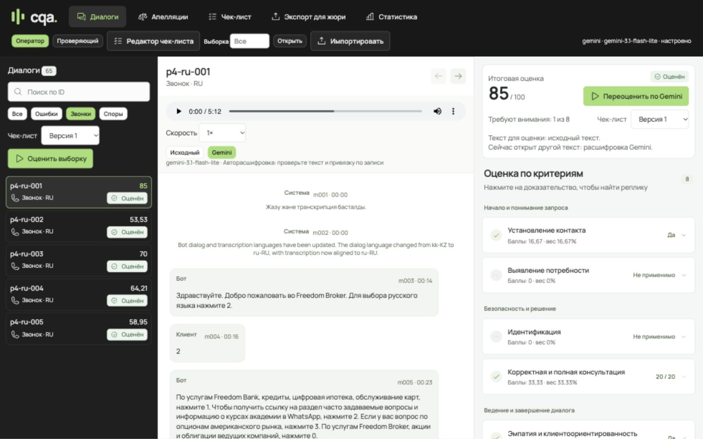

# Saw-cell: объединение интерфейса и Gemini

Рабочая ветка — `codex/teammate-workspace-gemini`. Основа — наша версия с проверенным
экспортом для жюри. Из архива тиммейта взята компоновка рабочего пространства.

## Получившаяся версия

- Слева лента диалогов, поиск, фильтры, выборка и запуск оценки; в центре переписка
  и запись звонка; справа оценка и редактор чек-листа. Сохранены апелляции,
  статистика, версии чек-листа и экспорт для Saw-cell.
- Используются наши локальные Manrope и Phosphor, тёмная навигация, светлые панели
  и лаймовый акцент. Новых внешних библиотек интерфейса нет.
- Основной сервер остаётся Node/Express/SQLite. Python-сервер из архива,
  предрасчитанные оценки и ручные замены расшифровок не импортированы.
- Аудио воспроизводится через локальный сервер с HTTP Range. Перемотка по
  доказательству сохраняет связь с исходной позицией реплики.
- Транскрипция отправляет настоящее аудио в Gemini API. Обычный исходный текст
  не передаётся как подсказка. Служебные строки, маски и одиночные цифры меню
  защищены от замены; ID, роли и временные метки берутся из исходных данных.
- Для длинного звонка ответ запрашивается частями по 50 ID с общей записью.
  Строгая схема требует текст для каждого ID. Неполный или некорректный ответ
  не сохраняется как готовая расшифровка.
- «Исходный / Gemini» переключает текст. «Переоценить по Gemini» создаёт оценку
  по выбранной готовой расшифровке. Карточка показывает источник текущей оценки
  и сообщает, если открытый текст отличается от использованного.
- Очередь сохраняет снимок текста для восстановления после перезапуска. Кеш
  оценки разделён по источнику и хешу расшифровки; кеш аудио учитывает исходные
  реплики, запись, модель и версию промпта.
- Дневное исчерпание квоты Gemini прекращает повторы. Ошибка распознавания
  показывает примерное время ожидания из ответа провайдера. Модель не меняется
  автоматически и не заменяется эвристикой.

Локально выбрана `gemini-3.1-flash-lite` для оценки и распознавания. Предыдущая
`gemini-3.5-flash-lite` достигла дневной квоты проекта при проверке. Выбранная
модель видна в интерфейсе и сохраняется вместе с результатом. Ключи остаются
в игнорируемом `.env`; файлы MP3, база и полные ответы моделей тоже локальные.

## Проверка объединения

Автоматические проверки (125 тестов): `npm test`, `node server/verify-start.js`,
`node scripts/e2e-stub.js`, проверка официального DEV JSON и `git diff --check`.
Обычные тесты используют подменённые внешние сервисы.

Реальная проверка API выполнена отдельно на пяти MP3: 386 реплик, все пять
расшифровок завершены. Обезличенные числовые
результаты, число реплик, ответы аудиосервера и токены проверочной оценки —
[merge-verification.json](qa/merge-verification.json).

В браузере проверены рабочее пространство при 1440 × 900, отсутствие горизонтального
переполнения при 390 × 844, редактор, переключение расшифровки, доступность
переоценки и переход по доказательству к аудио. Пример: m025 первого звонка
подсвечивается и перематывает запись к исходной отметке около 130 секунд.

Исходные сообщения сверены с резервной копией до объединения и не изменились.
Сохранённый `results/dev/results.json` также не изменился. Проверочная оценка Gemini
выполнена на отдельной копии БД, чтобы не смешать её с DEV-прогоном Algos и его
происхождением. Для новой сдачи после переоценки нужен новый проверенный экспорт.

## Практические ограничения

Проверка полного набора ID подтверждает структуру, но не доказывает точность речи
и семантической привязки каждой фразы. Модель может сместить фразу на соседнюю
реплику. В интерфейсе предложена проверка текста и привязки по записи перед оценкой.
Независимая ручная разметка и измерение качества ASR ещё не выполнены.

Маски исходного текста сохраняются, новые телефоноподобные идентификаторы и email
в маскированных звонках маскируются. Свободный текст, включая личные имена, требует
отдельной проверки; этот фильтр не является полной системой обезличивания.

Стоимость в статистике — расчёт по заданным коэффициентам для вызовов оценки.
Это не выписка биллинга и не полный учёт стоимости распознавания аудио.

Контракты: [Gemini audio API](GEMINI_AUDIO_API.md),
[интерфейс](WORKSPACE_MERGE.md). Документация провайдера:
[аудио](https://ai.google.dev/gemini-api/docs/audio),
[Gemini 3.1 Flash-Lite](https://ai.google.dev/gemini-api/docs/models/gemini-3.1-flash-lite).
